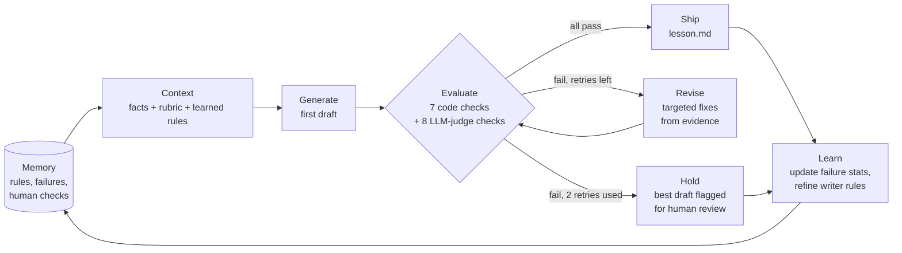

# LessonForge: a self-evaluating lesson generator

LessonForge is an agentic workflow. It **writes** a beginner lesson, **judges** it against a strict pass/fail rubric, and **rewrites** it until it passes. It **learns** from its own failures across runs.

- **Topic:** Introduction to RAG (Retrieval-Augmented Generation)
- **Learner:** a 12th-grade graduate from India, from a non-English-medium school, with limited English and zero AI background



The design reasoning, trade-offs and rubric rationale are in **[DESIGN.md](DESIGN.md)**.

---

## Quick start (about 2 minutes)

```bash
git clone <this-repo> && cd lessonforge
python -m venv .venv && source .venv/bin/activate      # Windows: .venv\Scripts\activate
pip install -r requirements.txt                        # optional: core needs only Python 3.10+
cp .env.example .env                                   # then put ONE API key in .env
python -m lessonforge run
```

The final lesson goes to `outputs/latest/lesson.md` and the rejection log to `outputs/latest/rejection_log.md`.

> **No API key?** `python -m lessonforge run` still works. It falls back to an **offline mock model**: canned drafts and a heuristic judge. This lets you see the loop, logs and outputs without spending anything. Every real run uses a real LLM for every step.

### Free API key options
- **Gemini:** free key at https://aistudio.google.com/apikey. Set `GEMINI_API_KEY`.
- **Groq:** free key at https://console.groq.com/keys. Set `OPENAI_COMPAT_API_KEY`.
- Anthropic and OpenAI keys work too.

**Free-tier tip:** Gemini's free tier allows only ~20 requests/day per model, and one run needs 10–29 calls. The setup that works on free keys is Gemini as the writer and Groq (`openai/gpt-oss-120b`) as the judge (see `.env.example`). It also reduces self-grading bias.

**Recommended:** use a *different* model as the judge to reduce self-grading bias. See `LF_JUDGE_PROVIDER` in `.env.example`.

---

## Commands

| Command | What it does |
|---|---|
| `python -m lessonforge run` | Full loop: generate → evaluate → revise (max 2 retries) → ship or hold → learn |
| `python -m lessonforge run --inject-error factual` | **Demo:** plants a deliberate error in draft 1 so you can watch the evaluator catch it. Modes: `factual`, `jargon`, `ungrounded`, `structure` |
| `python -m lessonforge run --max-retries 0` | Shows the "hold for human review" path |
| `python -m lessonforge eval path/to/lesson.md` | Judges any lesson file with the rubric |
| `python -m lessonforge feedback "too many English idioms"` | Human feedback goes into memory and becomes writer rules on the next run |
| `python -m lessonforge add-check "Mentions an Indian example in every section"` | A human adds a new pass/fail rubric check (rubric evolution) |
| `python -m lessonforge stats` | First-try score per run, to see whether learning helps |
| `python -m lessonforge reset-memory` | Clears memory |
| `python -m pytest -q` | 16 offline tests: loop, termination, error catching, memory, fail-closed judge, retries, provider fallback |

Exit code `0` means shipped. Exit code `2` means not shipped (useful in CI).

---

## What a run produces

```
outputs/run_<timestamp>/
  lesson.md              final lesson (has a "NOT SHIPPED" banner if held for review)
  rejection_log.md       per-attempt scorecard: what failed, why (with evidence), what changed on retry
  rejection_log.json     same, machine-readable
  drafts/attempt_N.md    every draft, so you can diff the revisions
outputs/latest/          copy of the most recent run
memory/memory.json       persists across runs: failure stats, learned rules, human checks, run history
```

---

## Repository map

| File | Role |
|---|---|
| `lessonforge/pipeline.py` | The graph: nodes, routing, retry budget, ship/hold, learn. Uses LangGraph if installed, otherwise a built-in runner with the same nodes and edges |
| `lessonforge/generator.py` | Writes the first draft. On retry, makes **targeted revisions** using the failed checks and their evidence |
| `lessonforge/evaluator.py` | Runs code checks and one LLM-judge call per semantic check. Judge calls run in parallel, are fail-closed and must cite evidence |
| `lessonforge/checks_code.py` | Deterministic checks: structure, length, sentence length, readability, hard words, glossary, quiz |
| `lessonforge/rubric.json` | The 15 pass/fail checks, editable without code changes |
| `lessonforge/knowledge/rag.md` | Curated reference facts plus known misconceptions. The single source of truth for both the writer and the judge |
| `lessonforge/prompts.py` | Every prompt in one place: writer, reviser, judge, rule refiner |
| `lessonforge/memory.py` | Persistent JSON memory |
| `lessonforge/inject.py` | Deliberate-error injection for the demo |
| `lessonforge/llm.py` | Dependency-free client for Anthropic, OpenAI, Gemini and any OpenAI-compatible API, with retry and backoff |
| `lessonforge/mock.py` | Offline test double (no API key needed) |

## When a run ends in NEEDS_HUMAN_REVIEW
That's the fail-safe working: the system won't ship a lesson that fails any check. The human-in-the-loop path is:
1. Open `outputs/latest/rejection_log.md` to see exactly which check failed, with the quoted evidence.
2. Fix those lines in `outputs/latest/lesson.md` (remove the "NOT SHIPPED" banner).
3. Re-check the edited lesson against all 15 checks: `python -m lessonforge eval outputs/latest/lesson.md`
4. Optionally run `python -m lessonforge feedback "..."` so the writer learns from the fix next time.

## Free-tier setup that works (tested)
```
GEMINI_API_KEY=...                       # writer
LF_GEN_PROVIDER=gemini
LF_GEN_MODEL=gemini-3.6-flash            # or gemini-3.5-flash-lite (separate daily quota)
OPENAI_COMPAT_API_KEY=gsk_...            # Groq, judge
LF_JUDGE_PROVIDER=openai_compat
LF_JUDGE_MODEL=openai/gpt-oss-120b       # or openai/gpt-oss-20b / qwen/qwen3.8-27b (each has its own daily quota)
LF_JUDGE_WORKERS=1
```
A run takes 10–20 minutes on free tiers because of rate-limit backoff.

## Adding a new topic
Add `lessonforge/knowledge/<keyword>.md` (the keyword must appear as a word in the topic) with reference facts and misconceptions, then run `python -m lessonforge run --topic "<topic>"`. The rubric's topic-specific check (`J3_key_points`) lives in `rubric.json`.
